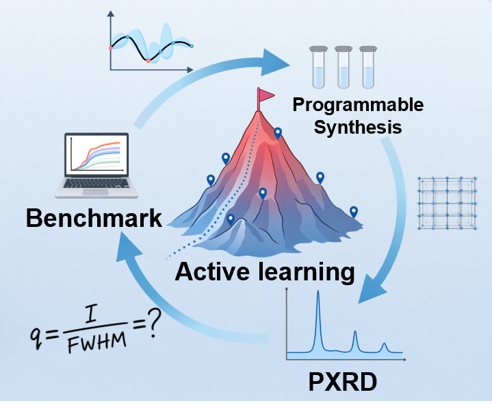

<div align="center">

# ActMOF

**Mapping reticular synthesis through active learning**

An experiment-grounded benchmark for choosing how to search MOF synthesis conditions

[](LICENSE)
[](requirements.txt)
[](data/)
[](docs/method_registry.csv)
[](wetlab/)
[](https://github.com/Mr-Thiol/ActMOF_Website)



</div>

---

## What is ActMOF?

Finding the conditions under which a metal-organic framework (MOF) crystallizes is a search problem: a handful of
experiments must locate a narrow window in a large space of amounts, times and temperatures. ActMOF makes this search
measurable.

- **A landscape.** 95 measured microwave syntheses of the Al MOF MOF-321 are extended, by two random forests and local
  blending with the measured points, to all 6,101,172 combinations of five synthesis variables. Every condition carries a
  crystallinity index `q` = intensity / FWHM of the diagnostic PXRD reflection (higher is better; `q = 0` means no product).
- **A benchmark.** 39 search strategies (Gaussian processes, tree ensembles, approximate and linear models, bandits,
  LLMs and GP-LLM hybrids) explore this landscape under one protocol: 3 starting experiments, then 39 iterations of
  3 experiments, 120 experiments in total.
- **A wet-lab test.** The strategy chosen on the benchmark, a Matern-5/2 Gaussian process with expected improvement
  started from the MOF-321 data, optimized six further Al MOFs (CAU-10, CAU-23, MIL-53-muc, MIL-160, MTV-MIL-160,
  MTV-MOF-303) in 12 experiments each.

| | |
|---|---|
| Synthesis variables | 5 (AlCl<sub>3</sub>&middot;6H<sub>2</sub>O, NaOH, added water, hold time, temperature) |
| Conditions on the landscape | 6,101,172 |
| Measured MOF-321 syntheses | 95 unique conditions (96 recorded entries) |
| Search strategies | 39, five runs each; six of them and random search with 20 runs |
| Budget per run | 120 experiments (3 + 39 &times; 3) |
| Validation campaigns | 6 MOFs &times; 12 experiments |

## Repository layout

```
data/                     the landscape and the measured syntheses it is built from
    design_grid_part*.csv     the 6.1M-row landscape (7 files, ~233 MB)
    anchors_mof321.csv        the 96 recorded MOF-321 syntheses
dataset_construction/     rebuilds the landscape from the measured syntheses
benchmark/                the 39 search strategies
    run_all_methods.py        single entry point
    families/                 7 scripts (one covers 29 strategies, six cover the other 10)
    reference_output/         results and logs of the runs reported in the paper
analyses/                 further analyses of the Supporting Information
    landscape_reliability/    leave-one-out test; support of the landscape by the data   (SI S2.5)
    landscape_robustness/     41 landscapes rebuilt with other construction choices      (SI S4.4)
    pi_vs_ei/                 shared starting conditions and measurement noise            (SI S4.5)
    warm_start/               starting the search from the prior                          (SI S4.6)
    no_product_region/        modeling "product / no product" separately                  (SI S4.7)
wetlab/                   the six validation campaigns
    campaigns/                recipes and results of every experiment
    pxrd/                     PXRD patterns, peak-reading script, reflux references, CIFs
    sorption/                 N2 isotherms, BET and Langmuir areas
docs/                     data dictionary; code names and paper names of the 39 strategies
```

## Quickstart

```bash
git clone https://github.com/deep-synthesis/ActMOF.git
cd ActMOF
pip install -r requirements.txt
```

The landscape is shipped in `data/`; nothing has to be built first.

```bash
# 30 of the 39 strategies need neither R nor an API key
python benchmark/run_all_methods.py --only core29_gp_ml_tree_rl_mof,rvm_like

# all 39 (needs R with laGP and RobustGaSP for 4 strategies, an OpenAI API key for 5)
python benchmark/run_all_methods.py
```

The results of the runs reported in the paper are in [`benchmark/reference_output/`](benchmark/reference_output/), so the
benchmark need not be rerun to inspect or re-plot them. [`benchmark/README.md`](benchmark/README.md) describes the R and
OpenAI set-up, the cost of the LLM runs and how their seeds and settings are fixed.

## The five variables

Every condition is a vector of five integers. One step of a code is one increment that can be dispensed or set exactly.

| Code | Variable | Range of the code | One step | Physical range |
|---|---|---|---|---|
| `metal_amount` | AlCl<sub>3</sub>&middot;6H<sub>2</sub>O stock solution (100 mg/mL) | 5-75 | 0.1 mL | 0.5-7.5 mL |
| `modulator` | NaOH stock solution (100 mg/mL) | 5-15 | 0.1 mL | 0.5-1.5 mL |
| `add_solvent` | additional DI water | 0-30 | 0.1 mL | 0-3.0 mL |
| `reaction_time` | microwave hold time | 1-12 | 5 min | 5-60 min |
| `reaction_temperature` | microwave temperature | 10-30 | 5 &deg;C | 50-150 &deg;C |

71 &times; 11 &times; 31 &times; 12 &times; 21 = 6,101,172 conditions. The validation syntheses use the same codes at one tenth of
the scale (one step = 10 &micro;L).

## Where to find what the paper reports

| In the paper | In this repository |
|---|---|
| The landscape and the 95 measured syntheses | [`data/`](data/), [`dataset_construction/`](dataset_construction/) |
| Best-so-far curves of the 39 strategies (5 runs) | [`benchmark/reference_output/all_methods_PERRUN_curves_UNIFIED.csv`](benchmark/reference_output/) |
| Six leading strategies and random search (20 runs) | [`benchmark/reference_output/leading_strategies_n20_PERRUN_curves.csv`](benchmark/reference_output/) |
| LLM prompts, answers, retries and fallbacks | [`benchmark/families/`](benchmark/families/), [`benchmark/reference_output/logs/`](benchmark/reference_output/logs/) |
| Reliability and robustness of the landscape | [`analyses/landscape_reliability/`](analyses/landscape_reliability/), [`analyses/landscape_robustness/`](analyses/landscape_robustness/) |
| PI versus EI, warm start, no-product region | [`analyses/`](analyses/) |
| Recipes, PXRD patterns and N<sub>2</sub> sorption of the six MOFs | [`wetlab/`](wetlab/) |
| The program used in the wet lab | [github.com/Mr-Thiol/ActMOF_Website](https://github.com/Mr-Thiol/ActMOF_Website) (web and desktop versions) |

Code names such as `GP_Matern52_EI_BASELINE` are translated to the names used in the paper in
[`docs/method_registry.csv`](docs/method_registry.csv).

## Requirements

Python 3.10 or later with the packages of [`requirements.txt`](requirements.txt). Optional: R with the `laGP` and
`RobustGaSP` packages and `rpy2` (4 strategies), and an OpenAI API key in the environment variable `OPENAI_API_KEY`
(5 strategies; calls are billed). No key is stored in this repository.

## Citation

If you use ActMOF, please cite:

> Sheng, H.; Liang, S.; Coyle, R. A.; Pal, S. C.; Walther, P.; Feng, B.; Ding, X.; Lin, N.; Zheng, Z.
> ActMOF: Mapping Reticular Synthesis through Active Learning.

The MOF-321 syntheses were first reported in: Zheng, Z., et al. ChatGPT Research Group for Optimizing the Crystallinity
of MOFs and COFs. *ACS Cent. Sci.* **2023**, *9*, 2161-2170.

## License

MIT; see [`LICENSE`](LICENSE).
